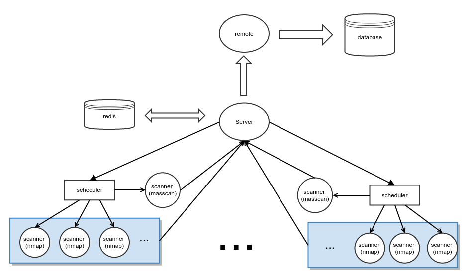

### 简介

本项目主要是实现对外网服务器端口的扫描，由于每天需要扫描一次，所以需要一定速度要求，单纯采用nmap来扫描无法满足要求，所以先使用masscan扫描出可能开发的端口，然后使用nmap来对开放的端口进一步扫描，提高扫描识别速度。

项目实现了简单的分布式，把任务派发到各个节点，这样可以根据需要扩展节点，提高扫描速度。

### 实现

实现主要分为三部分：

1. 发布任务：主要是cronjob.py。使用crontab来定时发布任务，发布任务主要是把masscan扫描的任务加入到Redis中，也就是要扫描的IP段，保存在wan\_ip.txt中，是从CMDB中导出后整理的。

2. 服务端：主要是server.py，使用了bottle开发，负责各个扫描节点获取任务，保存节点提交的扫描结果以及一些节点/任务信息（便于展示），最终结果会提交到安全中心的相应数据库中，供后续的统计发邮件。server也可以部署到多个节点，使用同一个redis。

3. 扫描节点：主要是scheduler.py与scanner.py，scheduler.py服务到服务端获取任务，然后交给相应的scanner处理，只要在每个节点起一个scheduler即可无缝扩展，同时scheduler可指定参数来启动指定nmap/masscan最大启动的数量。

其他：

- api.py: 扫描节点与server端通信的api封装。
- config.py：相关配置（可改为每次读取配置文件，修改后不需重启服务）
- database.py：操作数据库（未用到，直接提交到安全中心提供的接口来保存结果了）
- utils.py：工具类函数

结构图：

### 部署

部署采用了supervisor，bottle使用gunicorn。具体配置文件参见deploy目录：

- crontab：定时发布任务的crontab，使用`crontab -e`编辑添加即可。
- nginx.conf：nginx配置，作为server.py的反向代理。
- supervisord.conf：supervisor配置文件。
- requirements.txt：项目依赖的第三方库，使用命令`pip install -r requirements`安装。
- portscan.sql：存储结果的数据库结构，主要使用到portscan\_main。

另：

- /client/list 可以查看扫描节点，/task/status 可查看扫描进度。

### TODO

1. 图形化展示扫描节点/扫描进度等，接口已经实现
2. 不重启服务使得修改配置文件生效
3. WebAPI添加认证机制
4. Supervisor停止时杀死子进程
